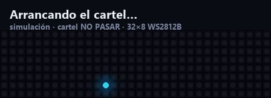

# 🚪 Cartel LED «NO PASAR / PASAR» para teletrabajo

Un cartel LED junto a la puerta que se pone en **rojo «NO PASAR»** cuando alguien está en una llamada (Teams, Meet, Zoom, una llamada de cliente…) y en **verde «PASAR»** cuando termina. El portátil y el cartel hablan por **WiFi** dentro de la red local.

La señal de «está en llamada» es simplemente **que el micrófono esté en uso**, no «hay Teams abierto». Así funciona con cualquier aplicación, sin integraciones ni permisos de empresa.



| | |
|---|---|
| 🌐 **Simulación web interactiva** | <https://granizocieza-cmyk.github.io/cartel-led-no-pasar-teletrabajo/> |
| 🔌 **Circuito en Wokwi** | [`simulacion-wokwi/`](simulacion-wokwi/README.md) (3 pasos para abrirlo en el navegador) |
| 🧪 **Pruebas** | `node pruebas/prueba_ciclo.js` · `python pruebas/comparar_firmware_web.py` · agente: `windows-service/tests` |

---

## Índice
1. [Cómo funciona](#cómo-funciona)
2. [Lista de materiales](#lista-de-materiales)
3. [Esquema de conexiones](#esquema-de-conexiones)
4. [Montaje, compilación e instalación paso a paso](#montaje-compilación-e-instalación-paso-a-paso)
5. [Endpoints del cartel](#endpoints-del-cartel)
6. [Decisiones de diseño](#decisiones-de-diseño)
7. [Consumo y brillo](#consumo-y-brillo)
8. [Nivel lógico 3,3 V → 5 V](#nivel-lógico-33-v--5-v)
9. [Simulación del firmware en Wokwi](#simulación-del-firmware-en-wokwi)
10. [Privacidad](#privacidad) · [Limitaciones](#limitaciones-conocidas) · [Ideas de mejora](#ideas-de-mejora)
11. [Estructura del repositorio](#estructura-del-repositorio) · [Licencia](#licencia)

---

## Cómo funciona

```mermaid<br/>flowchart LR<br/>    subgraph PC["💻 PC con Windows"]<br/>        A["cartel-agent.exe (C++)\nWASAPI: ¿alguna sesión de\nmicrófono en AudioSessionStateActive?"]<br/>        A --> B["Antirrebote + latido"]<br/>    end<br/>    B -- "HTTP GET /ocupado · /libre\n(WiFi, red local)" --> E<br/>    subgraph ESP["📟 ESP32 DevKit V1"]<br/>        E["Servidor HTTP + mDNS\ncartel.local"] --> L["Lógica de estado\nrojo · verde · neutro"]<br/>        L -- "IO16 + 330 Ω" --> M<br/>    end<br/>    PSU["🔌 Fuente 5 V 2–3 A\n+ 1000 µF"] --> M<br/>    M["Matriz WS2812B 8×32"]<br/>```

1. **El agente** (en el PC) pregunta a Windows cada segundo qué sesiones de **todos** los micrófonos están activas. Micro activo → *ocupado*.
2. **Antirrebote:** pasar a *ocupado* es inmediato; pasar a *libre* espera 5 s sin actividad (no parpadea si el micro se corta un instante).
3. **Solo habla cuando cambia el estado**, más un **latido** cada 15 s repitiendo el estado.
4. **El ESP32** recibe la petición, hace un barrido animado y dibuja el mensaje.
5. **Si no hay latido durante 45 s** (WiFi caído, portátil apagado o dormido), el cartel muestra un **`?` ámbar** en lugar de quedarse en «NO PASAR» para siempre.

---

## Lista de materiales

| Componente | Especificación | Función | Precio aprox. |
|---|---|---|---|
| Microcontrolador | ESP32 DevKit V1 (NodeMCU-32S, 30 pines) | WiFi + servidor HTTP + control de LEDs | 6–9 € |
| Matriz LED | WS2812B 8×32 (256 LEDs), 5 V, flexible o rígida | Muestra estado y mensaje | 15–25 € |
| Fuente | 5 V, 3 A (mejor 3 A que 2 A) con conector/bornas | Alimenta la matriz (**no** desde el USB del ESP32) | 8–12 € |
| Condensador | 1000 µF, ≥ 16 V (electrolítico) | En paralelo 5 V–GND junto a la matriz: absorbe picos | 0,5 € |
| Resistencia | 330 Ω, 1/4 W | En serie entre IO16 y DIN: protege la línea de datos | 0,1 € |
| Cables | Dupont M-M / M-H, protoboard | Cableado | 4–7 € |
| *(Recomendado)* Level shifter | 74AHCT125 (o 74HCT245) | Sube la señal de datos de 3,3 V a 5 V ([ver por qué](#nivel-lógico-33-v--5-v)) | 1 € |
| *(Opcional)* Cable micro-USB | Para programar el ESP32 | | — |
| **Total** | | | **≈ 35–55 €** |

> Los precios son orientativos (tiendas online generalistas, 2026). Si el panel trae ya conector de alimentación y cables, ahorras en cableado.

---

## Esquema de conexiones

```
   Fuente 5 V (2–3 A)
      │ +5V                                     │ GND
      ├───────────────┬──────────────────┐      ├──────────────┬────────────────┐
      │               │                  │      │              │                │
      │          ┌────┴────┐             │      │         ┌────┴────┐           │
      │          │ 1000 µF │ (+) larga   │      │         │ (−)     │           │
      │          └────┬────┘             │      │         └─────────┘           │
      ▼               ▼                  ▼      ▼                               ▼
  VCC matriz     (condensador       (opcional: VIN del ESP32,   GND matriz   GND ESP32 ◄── masas UNIDAS
  (5 V, rojo)     junto a la         ¡solo si NO hay USB!)      (blanco)
                  matriz)

  ESP32 IO16 ──[ 330 Ω ]──► DIN matriz (verde)      ← datos
```

Reglas de oro:
- **GND de la fuente, de la matriz y del ESP32 unidos** (imprescindible: sin masa común los datos no se entienden).
- **Condensador** con la pata larga (+) a 5 V y la corta (−, franja) a GND, **lo más cerca posible** de la entrada de alimentación de la matriz.
- **Fuente externa a la matriz.** Nunca alimentes 256 LEDs desde el USB del ESP32 ni desde su pin 5 V.
- **No conectes los 5 V de la fuente al pin VIN del ESP32 mientras esté conectado el USB** (podrías hacer retroalimentación). Programa con USB y la fuente de la matriz apagada, o alimenta el ESP32 solo desde USB.
- Conecta primero GND, luego 5 V, y por último los datos.
- Mira la flecha del panel: los datos entran por **DIN** (a veces marcado «IN»), no por DOUT.

Esquema eléctrico del circuito simulado: [`simulacion-wokwi/diagram.json`](simulacion-wokwi/diagram.json).

---

## Montaje, compilación e instalación paso a paso

### 1. Monta el circuito
Sigue el esquema anterior. Antes de encender la fuente, comprueba con el polímetro que 5 V y GND **no** están en cortocircuito.

### 2. Firmware del ESP32 (PlatformIO)

Necesitas [VS Code + extensión PlatformIO](https://platformio.org/install/ide?install=vscode) o `pip install platformio`.

```bash
cd firmware-esp32
cp cartel/secrets.example.h cartel/secrets.h     # en Windows: copy cartel\secrets.example.h cartel\secrets.h
# Edita cartel/secrets.h con tu WiFi (2,4 GHz). Está en .gitignore: no se sube a GitHub.
pio run -e esp32dev -t upload                    # compila y sube por USB
pio device monitor                               # verás la IP y "http://cartel.local"
```

Al arrancar, el cartel muestra `...` mientras conecta, luego **desplaza su IP** por la pantalla y pasa al estado neutro `?` hasta que el PC le avise. Comprueba desde el móvil: `http://cartel.local/` (o la IP) tiene dos botones de prueba.

> ¿El texto sale desordenado? Tu panel está cableado distinto: cambia `MATRIZ_ORDEN` en `cartel/config.h` (0 = columnas en zigzag, 1 = filas, 2 = filas en zigzag).
> *También compila con el Arduino IDE:* abre `firmware-esp32/cartel/cartel.ino`, instala «Adafruit NeoPixel» y la placa «ESP32 Dev Module».
> *En Windows con rutas muy largas* (>200 caracteres) la toolchain del ESP32 puede fallar: clona el repo en una ruta corta como `C:\cartel`.

### 3. Agente de Windows

**Opción A — sin instalar Visual Studio (recomendada para empezar):**
```powershell
cd windows-service
py -m venv .venv
.venv\Scripts\pip install ziglang
powershell -ExecutionPolicy Bypass -File scripts\compilar-zig.ps1
```
Esto ejecuta las pruebas de lógica y deja `build\cartel-agent.exe`.

**Opción B — CMake + MSVC (Visual Studio Build Tools) o MinGW:**
```powershell
cd windows-service
cmake -S . -B build
cmake --build build --config Release
ctest --test-dir build -C Release --output-on-failure
```

**Comprobar que detecta tu micrófono** (sin instalar nada aún):
```powershell
.\build\cartel-agent.exe --estado
# microfono: libre (revisados 3 dispositivos)
```
Abre ahora una llamada o `https://meet.google.com` con el micro, y repítelo: debe decir `EN USO ... por: msedge.exe` (o `ms-teams.exe`, `chrome.exe`…).

**Instalar para que arranque solo al iniciar sesión, sin ventana:**
```powershell
powershell -ExecutionPolicy Bypass -File scripts\instalar-arranque.ps1
notepad "$env:LOCALAPPDATA\cartel-agent\config.ini"      # host = cartel.local (o la IP del cartel)
```
Esto copia el programa a `%LOCALAPPDATA%\cartel-agent\`, crea el acceso directo en la carpeta *Inicio* (no requiere administrador) y lo arranca. Para quitarlo: `scripts\desinstalar-arranque.ps1`.

Comandos útiles: `cartel-agent.exe --consola` (ver el registro en directo), `--parar`, `--ayuda`. El registro está en `%LOCALAPPDATA%\cartel-agent\agente.log`.

#### `config.ini` (todo configurable)

| Clave | Por defecto | Qué hace |
|---|---|---|
| `host` | `cartel.local` | Nombre mDNS o IP del ESP32 |
| `host_respaldo` | *(vacío)* | IP a probar si el nombre no resuelve |
| `puerto` | `80` | |
| `token` | *(vacío)* | Debe coincidir con `TOKEN_CARTEL` del firmware |
| `sondeo_ms` | `1000` | Cada cuánto se mira el micro |
| `latido_s` | `15` | Cada cuánto se repite el estado (debe ser < 45) |
| `retardo_libre_s` | `5` | Antirrebote antes de «PASAR» |
| `reintento_s` | `5` | Espera entre intentos tras un fallo de red |
| `timeout_http_ms` | `2000` | Tiempo máximo por petición |

### 4. Colócalo
Fija la matriz junto a la puerta, con la fuente cerca. Reserva una **IP fija** (reserva DHCP) para el ESP32 en tu router si `cartel.local` no funciona en tu red.

---

## Endpoints del cartel

Todos son `GET`. Si defines `TOKEN_CARTEL`, añade `?k=TU_TOKEN`.

| Ruta | Efecto |
|---|---|
| `/ocupado` | **NO PASAR** (rojo). También cuenta como latido |
| `/libre` | **PASAR** (verde). También cuenta como latido |
| `/estado` | JSON: `{"estado":"ocupado","segundos_desde_latido":3,"brillo":40,"ma_estimados":380,"ip":"…","wifi_rssi":-55,"uptime_s":…}` |
| `/brillo?v=N` | Cambia el brillo (0 – 48, tope fijo) hasta el próximo reinicio |
| `/` | Página con botones para probar desde el móvil |

Prueba rápida: `curl http://cartel.local/ocupado`

---

## Decisiones de diseño

| Decisión | Por qué |
|---|---|
| **Detección por micrófono (WASAPI)** | Funciona con cualquier app. Se consulta `IAudioSessionManager2` de **todos** los dispositivos de captura activos (no solo el predeterminado: mamá puede usar cascos con micro) y se considera «activo» si alguna sesión está en `AudioSessionStateActive`. Se ignoran las sesiones del sonido del sistema. |
| **Programa de usuario, no «servicio de Windows»** | Los servicios corren en la sesión 0, aislada, y desde ahí WASAPI no ve de forma fiable el audio del usuario. Además un programa de usuario no pide administrador. Se arranca desde la carpeta *Inicio*. |
| **Texto fijo con fuente 3×5 propia** | «NO PASAR» mide 30 px y cabe en 32×8 **sin scroll**: se lee de un vistazo al pasar. En lugar de scroll, hay animación: respiración suave del texto y puntitos que corren por los bordes. |
| **Transición de barrido** | Un frente blanco recorre la pantalla de izquierda a derecha en 0,7 s. Se parte del último fotograma visible, así que un cambio a mitad de barrido no produce saltos. |
| **Estado neutro por falta de latido** | Un cartel que se queda en rojo con el PC apagado es peor que no tener cartel. El `?` ámbar dice «no sé». |
| **Antirrebote asimétrico** | Pasar a «NO PASAR» es inmediato (es lo importante); volver a «PASAR» espera 5 s para no parpadear. |
| **GET que cambia estado + token opcional** | Simple de probar con el navegador o `curl`. No es seguridad fuerte (HTTP sin cifrar): evita bromas y errores en una red doméstica. |
| **Escalado de color propio, no `setBrightness`** | `setBrightness` de Adafruit modifica los datos ya guardados y pierde precisión al cambiarlo cada fotograma. |
| **Lógica probada fuera del hardware** | El estado del agente y las animaciones no dependen de Windows ni del ESP32: se prueban con micro simulado y se comparan píxel a píxel con la simulación web. |

---

## Consumo y brillo

Una WS2812B gasta hasta **60 mA** con R+G+B al máximo (20 mA por color). Con 256 LEDs:

| Escenario | Brillo | Corriente |
|---|---|---|
| Todo blanco, **sin limitar** (¡no pasa nunca!) | 255 | ≈ 15,4 A ❌ |
| Todo blanco | 48 (tope) | 256 × 60 mA × 48/255 + 0,26 A en reposo ≈ **3,1 A** |
| Todo blanco, tras el limitador | ≈ 25 | **1,8 A** ✅ |
| «NO PASAR» rojo (73 px, en el pico de la animación), brillo 40 | 40 | 73 × 20 mA × 40/255 + 256 mA en reposo ≈ **0,47 A** |
| «PASAR» verde (45 px), brillo 40 | 40 | ≈ **0,40 A** |

Dos protecciones por software (`config.h`):
1. **`BRILLO_MAX = 48`**: tope fijo; ni la web ni `/brillo` lo superan.
2. **`LIMITE_MA = 1800`**: el firmware estima los mA de **cada fotograma** (valor de cada canal × brillo + 1 mA de reposo por LED) y, si se pasa del presupuesto, baja el brillo solo para ese fotograma. Así una fuente de 2 A tiene margen.

El consumo estimado se ve en `/estado` y en la simulación web.

---

## Nivel lógico 3,3 V → 5 V

El ESP32 saca **3,3 V** por IO16, pero una WS2812B alimentada a 5 V espera un «1» de **al menos 0,7 × 5 V = 3,5 V** (datasheet). Estamos 0,2 V por debajo de la especificación.

- **Con la resistencia de 330 Ω y un cable corto suele funcionar**, porque el chip es más permisivo que su datasheet. Pero **no está garantizado**: depende del lote, la temperatura y el cable, y se manifiesta como parpadeos o colores raros.
- **Recomendación: añade un level shifter** (p. ej. **74AHCT125**, ≈ 1 €) alimentado a 5 V entre IO16 y DIN. El «AHCT» acepta 3,3 V como «1» y saca 5 V limpios. La resistencia de 330 Ω va entre la salida del 74AHCT125 y DIN.
- **Truco gratuito** si no tienes el chip: alimentar la **primera** WS2812B a un voltaje algo menor (~4,3 V con un diodo 1N4001 en serie con el +5 V de la matriz) baja su umbral a ~3 V. Funciona, pero cambia el brillo máximo y es una chapuza.

---

## Simulación del firmware en Wokwi

Hay un circuito completo (ESP32, matriz 8×32 en IO16, resistencia de 330 Ω y dos pulsadores que hacen de «PC»):

1. Entra en <https://wokwi.com/projects/new/esp32>.
2. Copia `diagram.json` y `libraries.txt` de [`simulacion-wokwi/`](simulacion-wokwi/) y los archivos de [`firmware-esp32/cartel/`](firmware-esp32/cartel) (sin `secrets.h`).
3. Pulsa ▶. Botón rojo = NO PASAR, verde = PASAR; 45 s sin pulsar = `?`.

El plan gratuito de Wokwi **no admite conexiones entrantes**, así que ahí el firmware se compila en modo `SIMULACION` (botones en vez de WiFi). Para ver el flujo de red completo usa la [simulación web](https://granizocieza-cmyk.github.io/cartel-led-no-pasar-teletrabajo/). Detalles y uso con VS Code en [`simulacion-wokwi/README.md`](simulacion-wokwi/README.md).

---

## Privacidad

- **El agente nunca graba ni lee audio.** Solo pregunta a Windows el **estado** de las sesiones de audio («activa / inactiva»), la misma información que usa el icono de micrófono de la barra de tareas. El código no contiene ninguna llamada que abra un flujo de audio ni lea muestras (mira [`mic_wasapi.cpp`](windows-service/src/mic_wasapi.cpp): solo `GetState`).
- Lo único que sale del PC es `GET /ocupado` o `/libre` a **tu red local**. Nada va a Internet.
- El registro local (`agente.log`) guarda qué programas usaron el micro (p. ej. `ms-teams.exe`) y cuándo. Está solo en tu PC, rota a 256 KB y puedes borrarlo.
- ⚠️ **Portátil de empresa:** instalar un programa que vigila el uso del micrófono puede **no estar permitido** por la política de seguridad de tu empresa (y un antivirus puede avisar de un `.exe` sin firmar). Pregunta a IT antes de instalarlo. Alternativa sin software en el portátil: usar los endpoints `/ocupado` y `/libre` con un botón físico o desde el móvil.

## Limitaciones conocidas

- **Solo Windows** (el agente usa WASAPI). La lógica está separada y se puede portar a macOS/Linux sustituyendo `mic_wasapi.cpp`.
- **Silenciar el micro dentro de Teams** normalmente mantiene la sesión activa → sigue en «NO PASAR». Cuando se cuelga del todo, se libera.
- Algunas apps mantienen el micro abierto sin llamada (grabadoras, dictado, ciertos plugins de ruido): el cartel dirá «NO PASAR» aunque nadie hable.
- El agente se ejecuta **por usuario**: si mamá cierra la sesión de Windows, no hay agente (el cartel pasará a `?` a los 45 s).
- `cartel.local` (mDNS) a veces no funciona en redes de empresa o con routers que aíslan clientes; usa `host_respaldo` con la IP.
- El ESP32 solo conecta a WiFi de **2,4 GHz**.
- HTTP sin cifrar y token opcional: protección ligera, pensada para una red doméstica.
- **Probado aquí:** firmware compilado (PlatformIO, ambos entornos), lógica del agente con micro simulado, detección WASAPI real con una app que abre el micro, flujo agente → HTTP, simulación web. **No probado:** el cartel físico, Teams y los navegadores (se detectan por la misma API; compruébalo con `--estado`), y la carga del circuito en Wokwi.

## Ideas de mejora

- 🖨️ **Carcasa impresa en 3D** con difusor (papel vegetal o PLA blanco fino) delante de la matriz y soporte de pared.
- 🔧 **Level shifter** 74AHCT125 en una PCB perforada.
- 🔘 Pulsador físico en el cartel para forzar «NO PASAR» (reuniones presenciales).
- 📅 Integrar el calendario (Outlook/Google) para avisar antes de una reunión.
- 🌗 Sensor de luz (LDR) para bajar el brillo de noche.
- 📲 Actualización OTA del firmware por WiFi.
- 🔐 HTTPS o firma HMAC en las peticiones.
- 🍎 Agente para macOS (CoreAudio) y Linux (PipeWire/PulseAudio).

---

## Estructura del repositorio

```
firmware-esp32/     Firmware (PlatformIO / Arduino IDE): cartel/ (código), pruebas/ (volcado de fotogramas)
windows-service/    Agente de Windows en C++ (WASAPI + WinHTTP), CMake, scripts de compilación e instalación, tests
simulacion-wokwi/   diagram.json, wokwi.toml y guía para Wokwi
docs/               Simulación web (GitHub Pages): index.html, css/, js/, img/
pruebas/            Comparación firmware ↔ web, prueba del ciclo completo, generador del GIF
```

## Licencia

[MIT](LICENSE) © 2026 granizocieza-cmyk
